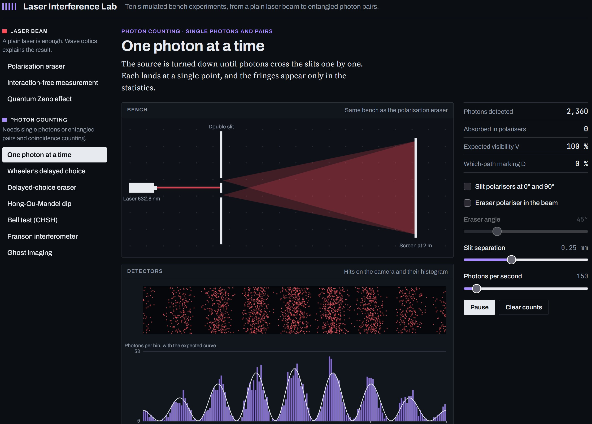

# Laser Interference Lab

Ten simulated optics-bench experiments in a single web page, from a polarisation quantum eraser with a plain laser beam to Bell tests and ghost imaging with entangled photon pairs.

**Live demo:** <https://jurgenkobierczynski.com/Laser_Interference_Lab/Laser_Interference_Lab.html>

## Screenshot

Each experiment has a bench schematic, live detector output, adjustable controls, key readouts, and a short note on what is ordinary wave optics and what needs quantum mechanics.

## Experiments

### Laser beam

A plain laser is enough, and wave optics explains the result.

| Experiment | What it shows | Link |
| --- | --- | --- |
| Polarisation quantum eraser | Polarisers over the two slits mark the path and remove the fringes. A third polariser at 45° brings them back. | [`#eraser`](https://jurgenkobierczynski.com/Laser_Interference_Lab/Laser_Interference_Lab.html#eraser) |
| Interaction-free measurement | The Elitzur-Vaidman bomb test in a Mach-Zehnder interferometer, with a laser beam or single photons. | [`#bomb`](https://jurgenkobierczynski.com/Laser_Interference_Lab/Laser_Interference_Lab.html#bomb) |
| Quantum Zeno effect | A chain of polarisation rotators. A polariser after every step freezes the rotation. | [`#zeno`](https://jurgenkobierczynski.com/Laser_Interference_Lab/Laser_Interference_Lab.html#zeno) |

### Photon counting

These need single photons or entangled pairs, and coincidence counting.

| Experiment | What it shows | Link |
| --- | --- | --- |
| One photon at a time | Double-slit fringes build up dot by dot, with optional path markers and eraser. | [`#buildup`](https://jurgenkobierczynski.com/Laser_Interference_Lab/Laser_Interference_Lab.html#buildup) |
| Wheeler's delayed choice | The second beam splitter is inserted or removed at random after the photon is inside the interferometer. | [`#wheeler`](https://jurgenkobierczynski.com/Laser_Interference_Lab/Laser_Interference_Lab.html#wheeler) |
| Delayed-choice quantum eraser | The raw signal detector shows no fringes. The coincidence-sorted subsets do. | [`#dcqe`](https://jurgenkobierczynski.com/Laser_Interference_Lab/Laser_Interference_Lab.html#dcqe) |
| Hong-Ou-Mandel dip | Two identical photons at a beam splitter always leave together. Scan the delay stage to trace the dip. | [`#hom`](https://jurgenkobierczynski.com/Laser_Interference_Lab/Laser_Interference_Lab.html#hom) |
| Bell test (CHSH) | Entangled pairs reach S ≈ 2.83. A local hidden-polarisation source stops at 2. | [`#bell`](https://jurgenkobierczynski.com/Laser_Interference_Lab/Laser_Interference_Lab.html#bell) |
| Franson interferometer | Single count rates stay flat while the coincidences show fringes in φA + φB. | [`#franson`](https://jurgenkobierczynski.com/Laser_Interference_Lab/Laser_Interference_Lab.html#franson) |
| Ghost imaging | The object appears only in the camera frames gated by a bucket detector that has no spatial resolution. | [`#ghost`](https://jurgenkobierczynski.com/Laser_Interference_Lab/Laser_Interference_Lab.html#ghost) |

## Running it locally

Open `Laser_Interference_Lab.html` in a current browser. There is nothing to build or install.

The page is one self-contained file: HTML, CSS and JavaScript, drawn on `<canvas>`. Its only external request is for three web fonts from Google Fonts (Archivo, Source Serif 4, JetBrains Mono). Without a connection it falls back to system fonts and works the same.

It follows the browser's light or dark setting and works at phone width.

## How the simulation works

Each experiment uses the standard textbook model for its setup.

- **Laser-beam experiments** compute intensities directly: two-slit interference under a single-slit envelope, Malus's law for the polarisers, and beam-splitter amplitudes for the interferometer.
- **Photon-counting experiments** draw individual detection events at random from the quantum-mechanical probabilities, then build histograms and coincidence counts from those events. The scatter in the plots is real counting noise from the simulation.
- **The Bell test** offers two sources. The entangled source follows the cosine correlation. The hidden-polarisation source is a local model in which each pair carries a shared polarisation that fixes both outcomes, giving a triangle-wave correlation and S ≤ 2.

Geometry uses realistic bench values where it matters: a 632.8 nm HeNe laser, 0.04 mm slits, a screen at 2 m, a 405 nm pump with 810 nm pairs.

### Limits of the model

- Detectors are ideal: no dark counts, dead time, or losses apart from the polarisers and the object in the beam.
- Optics are perfectly aligned and beam splitters are lossless.
- The delayed-choice eraser uses one common envelope for all detector subsets. The real experiment shows slightly shifted envelopes for the two which-path detectors.
- The page illustrates the physics. It is not a design tool for a real bench.

## Files

| File | Purpose |
| --- | --- |
| `Laser_Interference_Lab.html` | The whole application |
| `LICENSE` | GNU General Public License, version 3 |
| `README.md` | This file |

## Licence

Copyright © 2026 Jurgen Kobierczynski

This program is free software: you can redistribute it and/or modify it under the terms of the GNU General Public License as published by the Free Software Foundation, version 3 of the License.

This program is distributed in the hope that it will be useful, but WITHOUT ANY WARRANTY; without even the implied warranty of MERCHANTABILITY or FITNESS FOR A PARTICULAR PURPOSE. See the [LICENSE](LICENSE) file for the full text.
